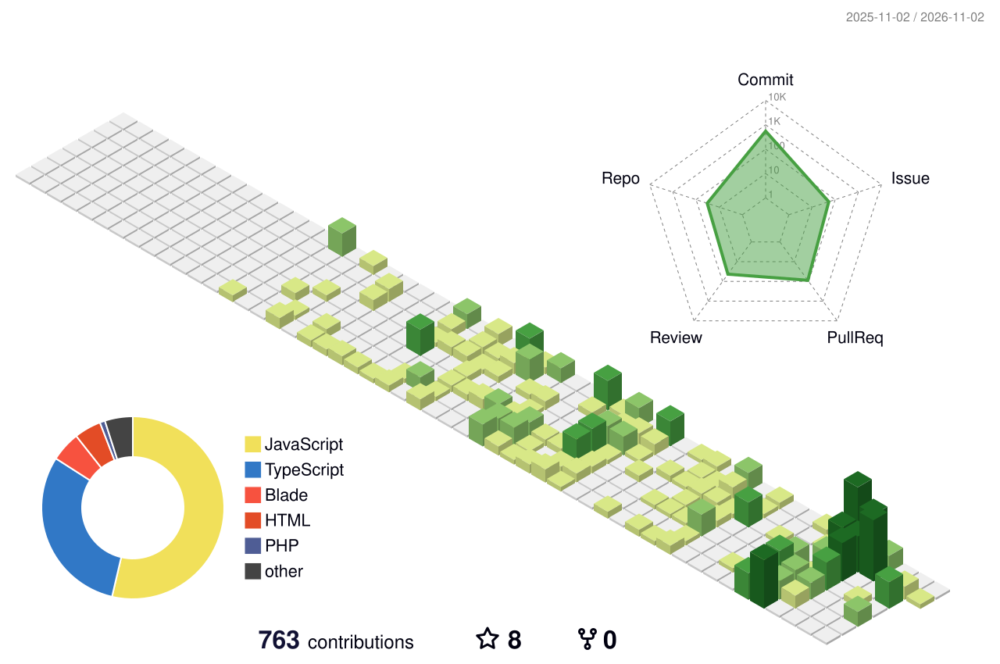

**I build and deploy full-stack web apps: multi-tenant SaaS, real payment gateways, and AI features on live data.**

**Open to Junior Software Engineer roles** · Central Java, Indonesia · Remote or on-site

## At a Glance

- **3 full-stack apps deployed and live**: [KasirAI](https://sikasirai.com), [TrustPay](https://trust-pay-blush.vercel.app), [KostKu](https://kostku-app-zeta.vercel.app)
- **End-to-end ownership**: database design, REST API, frontend, payments, Docker, deployment, DNS
- **Payments and AI in live apps**: Midtrans in production mode (per-tenant keys, webhooks) and Groq Llama querying live sales data
- **Dibimbing.id Full Stack Web Development Bootcamp** graduate, score 97.26 (A+)
- **Information Systems** graduate from Universitas Terbuka, building in the evenings alongside a full-time job

## Featured Projects

### KasirAI · AI-Powered Multi-Tenant POS

Point of Sale SaaS for Indonesian SMEs with an AI assistant that answers sales questions in natural language ("produk apa yang paling laku?") from live data.

**[Live: sikasirai.com](https://sikasirai.com)** · **[Repo](https://github.com/saifudinreza/pos-system)**

- Multi-tenant architecture with per-tenant data isolation and per-tenant Midtrans keys
- 36 REST API endpoints, role-based auth (Admin/Cashier) via Laravel Sanctum
- AI sales assistant on Groq Llama 3.3 70B, WhatsApp receipts via Fonnte, real-time stock alerts
- Dockerized Laravel API on Railway (Nginx), Next.js on Vercel, custom domain, GA4

`Next.js 14` `Laravel 11` `MySQL` `Zustand` `Groq Llama 3.3` `Midtrans` `Docker`

### TrustPay · Ledger-Based Digital Wallet

E-wallet where every rupiah is recorded: top up, peer-to-peer transfer, bill payment, and QR payments.

**[Live demo](https://trust-pay-blush.vercel.app)** · **[Repo](https://github.com/saifudinreza/TrustPay)**

- Atomic P2P transfers using DB transactions and `lockForUpdate`, with double-entry ledger rows linked by a transfer code
- Money math with `bcmath`, 6-digit PIN on every transfer and payment, anti-enumeration error messages
- Top up via Midtrans Snap with webhook confirmation, Google OAuth, WhatsApp OTP login
- Ledger export to CSV and printable PDF

`Laravel 13` `PHP 8.4` `React 18` `Vite` `PostgreSQL` `Midtrans` `Docker` `Render`

### KostKu · Boarding House Management SaaS

Dashboard for boarding house owners to manage properties, tenants, and invoices.

**[Live](https://kostku-app-zeta.vercel.app)** · **[Repo](https://github.com/saifudinreza/kostku-app)**

- 9-table schema and 35+ REST API endpoints
- Tenant and invoice tracking, email notifications, analytics charts
- Next.js frontend on Vercel, Laravel API on Render

`Next.js 16` `React 19` `TypeScript` `Tailwind v4` `TanStack Query` `Laravel` `Recharts`

### AgentMon · Review Layer for AI Coding Agents (in progress, private until beta)

Local-first tool for reviewing what coding agents like Claude Code want to do, with risk levels and policy rules instead of blind approvals.

- Local daemon that receives Claude Code HTTP hooks, bound to `127.0.0.1` only
- Layered request checks: Host validation against DNS rebinding, browser request rejection, and bearer token auth
- Privacy by default: logs record event and tool names, never code or commands
- Shared event contract in a pnpm monorepo, built issue by issue through pull requests

`TypeScript` `pnpm workspaces` `Vitest` `Claude Code Hooks`

### Loka Living · Furniture E-Commerce (in progress)

Furniture storefront with a warm, eco-inspired design, animated product transitions, and a full checkout flow. Built spec-first from a PRD and technical docs.

**[Repo](https://github.com/saifudinreza/Loka-living)**

`Next.js 14` `TypeScript` `Bun` `Elysia` `Drizzle ORM` `PostgreSQL` `Zustand` `Zod`

## Tech Stack

  

| Area | Tools |
|---|---|
| **Languages** | PHP, TypeScript, JavaScript, SQL |
| **Frontend** | Next.js, React, Tailwind CSS, Zustand, TanStack Query |
| **Backend** | Laravel (Sanctum, REST API), Bun + Elysia, Drizzle ORM |
| **Database** | MySQL, PostgreSQL |
| **Integrations** | Midtrans, Groq API, Google OAuth, Fonnte WhatsApp, Claude Code Hooks |
| **DevOps** | Docker, Nginx, Vercel, Railway, Render, Git |

## Contribution Activity

  

## Currently

- Building **AgentMon**, a local-first review layer for AI coding agents
- Continuing **Loka Living** on a TypeScript backend (Bun + Elysia + Drizzle)
- Practicing data structures and algorithms

